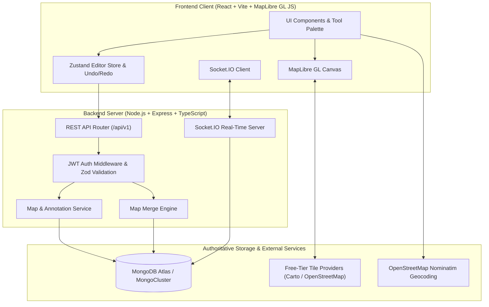
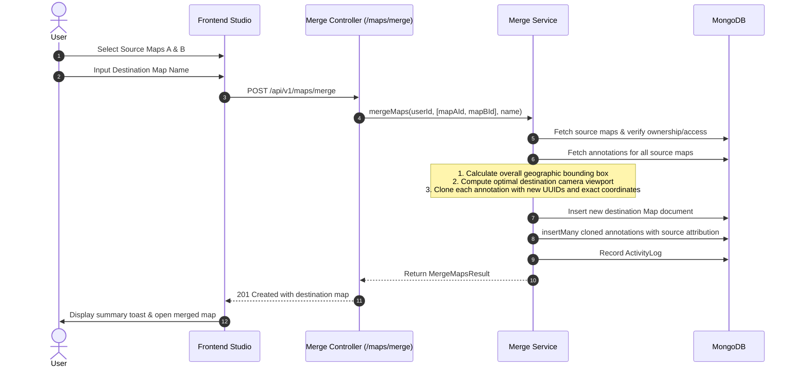

# MapForge — System Architecture & Design Document

## 1. System Overview

**MapForge** is a full-stack, collaborative geospatial mapping platform built for interactive map editing, annotation persistence, multi-map merging, and real-time collaborative editing.

The central design principle of MapForge is:
> **Every annotation must remain permanently anchored to its intended geographic location ($[\text{longitude}, \text{latitude}]$). Never store a marker or a permanent drawing solely as screen pixels.**

---

## 2. Geographic Coordinate Preservation

### 2.1 Geographic vs Screen Coordinates
- Screen coordinates ($x, y$ pixels) change on every pan, zoom, resize, or device orientation change.
- Storing screen coordinates would cause drawings to float across the screen or disconnect from their real-world landmarks.
- MapForge uses the **WGS 84 (EPSG:4326)** standard coordinate system represented as standard GeoJSON:
  - Coordinate order: `[longitude, latitude]`
  - Longitude: $-180^\circ$ to $+180^\circ$
  - Latitude: $-90^\circ$ to $+90^\circ$

### 2.2 Freehand Drawing Algorithm
1. **Pointer Event Capture**: During drawing pointer interactions, screen pixels $(x, y)$ are converted to geographic coordinates using the camera's current Mercator projection:
   $$\text{LngLat} = \text{map.unproject}([x, y])$$
2. **Camera Locking**: While drawing is active (`pointerdown`), map panning is temporarily locked (`map.dragPan.disable()`) so the map does not drift under the pointer. Normal panning resumes immediately on `pointerup`.
3. **Ramer-Douglas-Peucker (RDP) Simplification**:
   Pointer drag events produce hundreds of dense raw coordinates. MapForge executes the Ramer-Douglas-Peucker algorithm using a geographic tolerance threshold ($\epsilon \approx 0.00003^\circ$, approximately $3\text{ meters}$):
   - Computes perpendicular distance from intermediate points to the chord connecting segment endpoints.
   - Preserves endpoints and all inflection vertices exceeding $\epsilon$.
   - Reduces point density by up to $75\%$ while preserving 100% of topological shape and geographic accuracy.
4. **GeoJSON LineString Storage**: The simplified sequence is persisted as a GeoJSON `LineString` document in MongoDB.
5. **Dynamic Projection Rendering**: When the map renders, MapLibre GL projects the stored geographic coordinates onto the screen dynamically. Zooming, panning, and resizing always keep the stroke anchored to the terrain.

---

## 3. Map Merging System

The map merging engine combines annotations from two or more distinct saved maps into a new, independent destination map:

### Key Merge Invariants
- **Non-Destructive**: Source maps and their original annotations are never modified or deleted.
- **Independence**: The merged map receives freshly minted UUIDs for each annotation. Future edits to the source maps do not impact the merged map, and vice-versa.
- **Coordinate Fidelity**: Coordinates are transferred directly without translation, re-centering, or pixel approximations.
- **Viewport Optimization**: Destination camera center and zoom are derived from the bounding box enclosing all imported annotations.

---

## 4. Real-Time Collaboration Architecture

Collaborative rooms use **Socket.IO** with authenticated WebSockets and server-persisted operations:

- **Monotonic Sequence Ordering**: Every committed operation (`create`, `update`, `delete`, `batch`) is assigned an incrementing sequence number `seq` per room.
- **Authoritative Persistence**: Edits are persisted directly into MongoDB. Sockets are never treated as the authoritative database.
- **Deduplication**: Every operation carries a client-generated UUID `opId`. The server enforces unique indexing to prevent duplicate writes on network retry.
- **Transient vs Permanent Channels**:
  - High-frequency pointer movements are broadcast via `cursor:move` without touching the database.
  - Completed annotations and property edits are validated and stored permanently.
- **Presence Tracking**: Room members maintain active presence, unique avatar colors, and join/leave status.

---

## 5. Security & Data Integrity

- **Password Security**: Passwords hashed using `bcryptjs` with 10 salt rounds.
- **Authentication**: Stateless short-lived JWT access tokens with structured payload.
- **Server-Side Authorization**: Every CRUD operation validates that the requesting user owns the resource or holds explicit edit permission.
- **Input Validation**: All API payloads and socket operations are validated using strict Zod schemas against NoSQL injection and malformed GeoJSON.
- **Security Headers & CORS**: Configured with Helmet, CORS whitelist, and Express rate limiting on sensitive routes.
