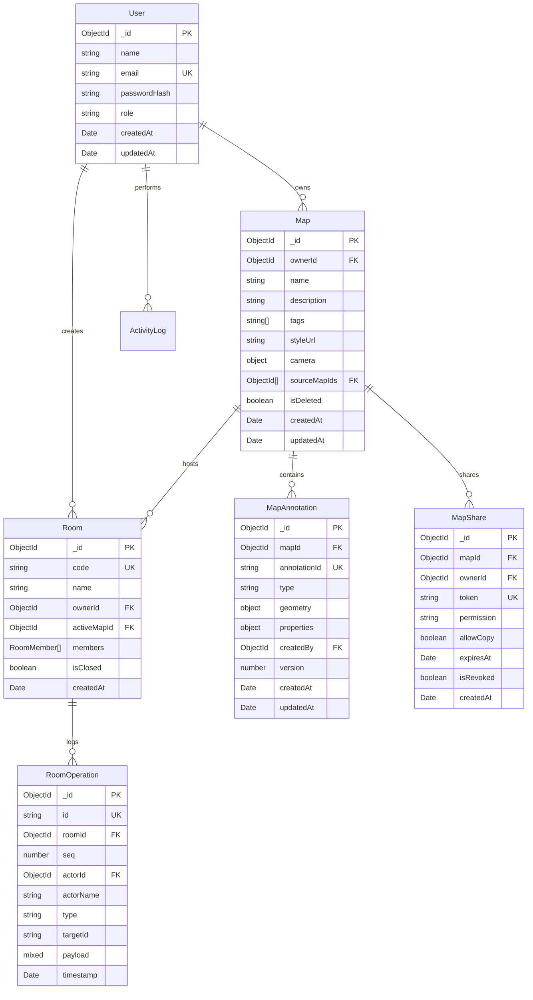

# MapForge — Database Schema Reference

## 1. Overview & Architectural Principles

MapForge uses MongoDB Atlas (compatible with the M0 Free Cluster) with Mongoose as the Object Data Modeling (ODM) layer.

Key design principles:
- **Bounded Documents**: Rather than embedding unlimited annotations inside a single map document, each annotation is stored as an independent document in `mapannotations`. This guarantees performance and stays well below MongoDB's 16MB document size limit.
- **GeoJSON Compliant**: Geographic geometry is stored directly according to GeoJSON specification (`Point`, `LineString`, `Polygon`) with `[longitude, latitude]` coordinates.
- **Deterministic Indexing**: Indexes support instant lookup by map ownership, room codes, and coordinate queries.

---

## 2. Collection Schemas

### 2.1 `users`
| Field | Type | Required | Description |
|---|---|---|---|
| `_id` | `ObjectId` | Yes | Primary Key |
| `name` | `String` | Yes | User display name |
| `email` | `String` | Yes | Lowercased, indexed unique email |
| `passwordHash` | `String` | Yes | bcrypt salt & hash |
| `role` | `String` | Yes | `"user"` \| `"admin"` |
| `createdAt` | `Date` | Yes | ISO timestamp |

**Indexes**:
- `{ email: 1 }` (unique)

---

### 2.2 `maps`
| Field | Type | Required | Description |
|---|---|---|---|
| `_id` | `ObjectId` | Yes | Primary Key |
| `ownerId` | `ObjectId` | Yes | Ref to `User` |
| `name` | `String` | Yes | User-defined map title |
| `description` | `String` | No | Map notes and survey details |
| `tags` | `String[]` | No | Categorization tags (e.g. `["fuel", "survey"]`) |
| `styleUrl` | `String` | Yes | Vector/raster tile style identifier |
| `camera` | `Object` | Yes | `{ center: { lat, lng }, zoom, pitch, bearing }` |
| `sourceMapIds` | `ObjectId[]` | No | Original map IDs when created via merge or duplication |
| `isDeleted` | `Boolean` | Yes | Soft-delete flag (default: `false`) |

**Indexes**:
- `{ ownerId: 1, isDeleted: 1, updatedAt: -1 }`

---

### 2.3 `mapannotations`
| Field | Type | Required | Description |
|---|---|---|---|
| `_id` | `ObjectId` | Yes | MongoDB Document ID |
| `mapId` | `ObjectId` | Yes | Ref to `Map` |
| `annotationId` | `String` | Yes | Cross-session stable client UUID |
| `type` | `String` | Yes | `"marker"` \| `"icon"` \| `"dot"` \| `"text"` \| `"freehand"` \| `"line"` \| `"polygon"` |
| `geometry` | `Object` | Yes | GeoJSON `{ type: "Point"\|"LineString"\|"Polygon", coordinates: [...] }` |
| `properties` | `Object` | Yes | `{ emoji, label, color, fillColor, strokeWidth, opacity, category, ... }` |
| `createdBy` | `ObjectId` | No | User who placed the annotation |
| `version` | `Number` | Yes | Optimistic concurrency revision counter |

**Indexes**:
- `{ mapId: 1, annotationId: 1 }` (compound unique)
- `{ mapId: 1, type: 1 }`

---

### 2.4 `mapshares`
| Field | Type | Required | Description |
|---|---|---|---|
| `_id` | `ObjectId` | Yes | Primary Key |
| `mapId` | `ObjectId` | Yes | Ref to `Map` |
| `ownerId` | `ObjectId` | Yes | Ref to `User` |
| `token` | `String` | Yes | 48-char cryptographically random unguessable token |
| `permission` | `String` | Yes | `"view"` \| `"edit"` |
| `allowCopy` | `Boolean` | Yes | Allows recipient to clone to independent copy |
| `expiresAt` | `Date` | No | Optional expiration timestamp |
| `isRevoked` | `Boolean` | Yes | Revocation status flag |

**Indexes**:
- `{ token: 1 }` (unique)
- `{ mapId: 1, ownerId: 1 }`

---

### 2.5 `rooms` & `roomoperations`
| Collection | Field | Type | Description |
|---|---|---|---|
| `rooms` | `code` | `String` | 6-char uppercase alphanumeric human-friendly code (unique) |
| `rooms` | `activeMapId` | `ObjectId` | Reference to live synchronized map |
| `rooms` | `members` | `Array` | Subdocuments with `userId`, `name`, `color`, `role`, `joinedAt` |
| `roomoperations` | `seq` | `Number` | Monotonically increasing sequence number per room |
| `roomoperations` | `type` | `String` | `"create"` \| `"update"` \| `"delete"` \| `"batch"` |
| `roomoperations` | `payload` | `Mixed` | Serialized operation delta |

**Indexes**:
- `rooms`: `{ code: 1 }` (unique)
- `roomoperations`: `{ roomId: 1, seq: 1 }`, `{ roomId: 1, id: 1 }` (unique)
